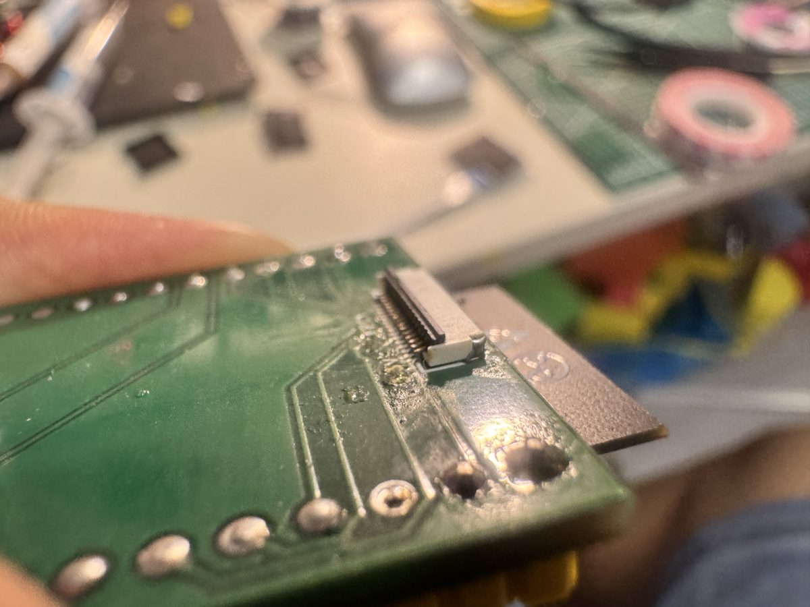
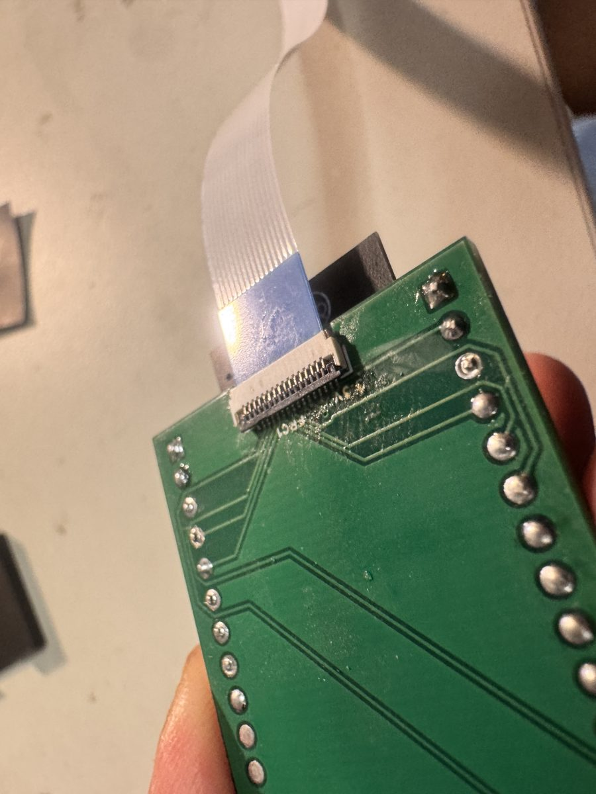
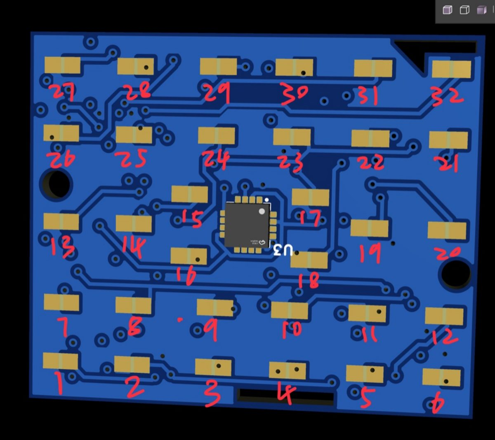
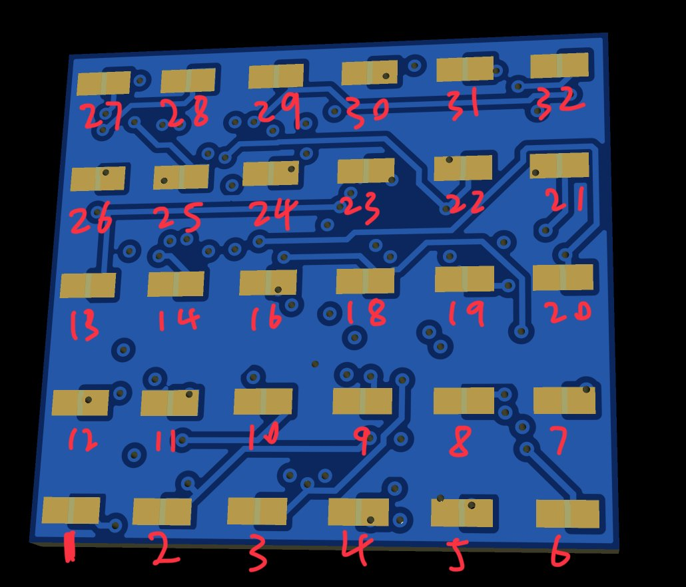

# 传感器使用说明 / Sensor Guide

[返回 / Back](../README.md)

## 0. 概述 / Overview

- **32 个压阻触点**：每个触点与 100 kΩ 以上的电阻组成分压电路，由两片 74HC4067PW 多路复用器接入 ESP32-S3 的 ADC1（12 位，0–4095）。
- **MLX90393**（可选）：位于 U3，测量磁铁位移引起的磁场变化，用来估计剪切力方向。传感器有**带 MLX90393** 和**不带 MLX90393** 两个版本，其余部分完全相同，固件会自动识别。
- **采样率**：32 路 ADC 和 MLX90393 均为 100 Hz。

- **32 piezoresistive taxels**: each taxel forms a voltage divider with a ≥100 kΩ resistor and is read through two 74HC4067PW multiplexers by the ESP32-S3 ADC1 (12 bit, 0–4095).
- **MLX90393** (optional): mounted at U3, it measures the field change caused by the magnet moving and is used to estimate the shear direction. The sensor comes in two versions, **with** and **without** the MLX90393; everything else is identical and the firmware detects which one is attached.
- **Sample rate**: 100 Hz for all 32 ADC channels and the MLX90393.

## 1. 连接 / Connection

### 1.1 FPC 排线 / FPC cable

FPC 排线两端都要按下面的步骤操作（传感器一侧和开发板一侧）：

1. 把 FPC 座上的**黑色卡扣向上掀起到竖直方向**。
2. 把 FPC 排线**蓝色加强面朝上**，平直地插到底。
3. 把黑色卡扣**放倒压紧**。

Do the following at **both ends** of the FPC cable (sensor side and board side):

1. Flip the **black latch** of the FPC connector **up to vertical**.
2. Insert the FPC cable straight and fully, with the **blue stiffener facing up**.
3. **Press the black latch back down** to lock the cable.

| ① 卡扣打开到竖直 / Latch open (vertical) | ② 蓝色面朝上插入，卡扣放倒 / Blue side up, latch closed |
|---|---|
|  |  |

> 插入时不要用力弯折排线；卡扣没有放倒时排线接触不可靠，可能出现部分通道读数异常。
> Do not bend the cable sharply. If the latch is not closed the contacts are unreliable and some channels may read wrong values.

### 1.2 USB

ESP32-S3 开发板有两个 USB 口（USB 和 COM），请连接 **COM 口**（USB 转串口芯片）。在 macOS 上它显示为 `/dev/cu.usbserial-XXXX`，Windows 上为 `COMx`。波特率 115200。

The ESP32-S3 board has two USB ports (USB and COM). Use the **COM port** (USB-UART bridge). It shows up as `/dev/cu.usbserial-XXXX` on macOS and `COMx` on Windows. Baud rate 115200.

### 1.3 引脚 / Pin map

| 功能 / Function | GPIO |
|---|---|
| MLX90393 SDA / SCL（I2C 地址 / address 0x0C） | 8 / 9 |
| MUX1 (74HC4067) S0–S3 / SIG | 4, 5, 6, 7 / 1 (ADC1_CH0) |
| MUX2 (74HC4067) S0–S3 / SIG | 11, 12, 13, 14 / 2 (ADC1_CH1) |

## 2. 触点编号 / Taxel layout

两个版本的电路连接完全相同：红色编号 1–16 对应 MUX1 的 CH0–CH15，17–32 对应 MUX2 的 CH0–CH15（编号 n → MUX1 CH(n−1)；编号 n ≥ 17 → MUX2 CH(n−17)）。区别只是触点的排布。

Both versions share the same wiring: red labels 1–16 are MUX1 CH0–CH15 and 17–32 are MUX2 CH0–CH15 (label n → MUX1 CH(n−1); label n ≥ 17 → MUX2 CH(n−17)). Only the taxel arrangement differs.

### 2.1 带 MLX90393（32 点）/ With MLX90393 (32 taxels)

注意从下往上第二行从**右往左**依次是 7–12。U3 周围的 15、16、17、18 用于 MLX90393 的自动归零。
Note that the second row from the bottom runs **right to left**: 7–12. Taxels 15, 16, 17 and 18 around U3 gate the MLX90393 auto-zero.



```
 27  28  29  30  31  32
 26  25  24  23  22  21
        15      17
 13  14     U3      19  20
        16      18
 12  11  10   9   8   7
  1   2   3   4   5   6
```

### 2.2 不带 MLX90393（30 点）/ Without MLX90393 (30 taxels)

6 × 5 排布，去掉了 **15 和 17** 两个触点，因此 **MUX1 CH14 和 MUX2 CH0 没有接触点**（可视化的数据文本里显示为 `--`）。
A 6 × 5 grid with taxels **15 and 17 removed**, so **MUX1 CH14 and MUX2 CH0 have no taxel** (shown as `--` in the visualizer's data text).



```
 27  28  29  30  31  32
 26  25  24  23  22  21
 13  14  16  18  19  20
 12  11  10   9   8   7
  1   2   3   4   5   6
```

## 3. 读数含义 / What the readings mean

- **ADC**：不受力时为 **4095**（输入 ≥ 约 3.1 V 时 ADC 饱和）；受力后电阻变化，读数**下降**，压力越大读数越低。
- **MLX90393**：配置为最不灵敏（最大量程）档：GAIN_SEL = 0，RES = 2，XY 约 ±66 mT（3.0 µT/LSB），Z 约 ±106 mT（4.8 µT/LSB），DIG_FILT = 5。适合磁铁离芯片非常近的情况。
- **上电时不要触碰传感器**：固件上电后取 20 次 MLX 读数的平均作为零点。
- 未检测到 MLX90393 时，MLX 数据全部显示 `N.A.`，固件每秒在后台重试一次。

- **ADC**: **4095** with no load (the ADC saturates above ≈3.1 V). Pressing changes the resistance and the reading **drops**; higher pressure gives a lower value.
- **MLX90393**: set to the least sensitive (largest range) mode: GAIN_SEL = 0, RES = 2, XY ≈ ±66 mT (3.0 µT/LSB), Z ≈ ±106 mT (4.8 µT/LSB), DIG_FILT = 5, for a magnet very close to the chip.
- **Do not touch the sensor at power-up**: the firmware averages 20 MLX readings as its zero.
- Without an MLX90393 all MLX values show `N.A.` and the firmware retries detection once per second.

## 4. 固件 / Firmware

### 4.1 编译与烧录 / Build and flash

需要 [ESP-IDF v5.5](https://docs.espressif.com/projects/esp-idf/en/v5.5/esp32s3/get-started/)。`sdkconfig.defaults` 已设置目标芯片 esp32s3 和 16 MB Flash。

Requires [ESP-IDF v5.5](https://docs.espressif.com/projects/esp-idf/en/v5.5/esp32s3/get-started/). `sdkconfig.defaults` already selects the esp32s3 target and 16 MB flash.

**命令行 / Command line**
```
. $HOME/esp/esp-idf-v5.5.x/export.sh
cd tactile_sensor
idf.py -p /dev/cu.usbserial-XXXX flash monitor      # Windows: -p COMx
```
退出监视器：`Ctrl+]`。/ Exit the monitor with `Ctrl+]`.

**VS Code**：安装 Espressif 的 ESP-IDF 扩展并完成配置，打开 `tactile_sensor` 文件夹，在底部状态栏选择目标 `esp32s3`、串口和烧录方式 UART，点 🔥（编译 + 烧录 + 监视器）。
**VS Code**: install and configure Espressif's ESP-IDF extension, open the `tactile_sensor` folder, pick target `esp32s3`, the serial port and flash method UART in the status bar, then click 🔥 (build + flash + monitor).

### 4.2 文本输出 / Text output

默认模式下，串口监视器每秒刷新 5 次，显示最新一帧（采样仍为 100 Hz）：
By default the serial monitor shows the latest frame 5 times per second (sampling stays at 100 Hz):

```
---- #40  t=0.77 s  100.0 Hz  frame 6.1 ms  missed 0
MLX   X=   -42.1 Y=  -153.2 Z=   -82.3 uT | dX=   +1.8 dY=   +0.3 dZ=   -0.2 uT | T=29.7 C
CH      0    1    2    3 ...   15
MUX1 4095 4095 4095 4095 ...
MUX2 ...
```

- `frame`：采一帧（32 路 ADC + MLX）的耗时，必须小于 10 ms / time to acquire one frame, must stay below 10 ms
- `missed`：丢掉的帧数，正常为 0 / frames that could not be processed in time, normally 0
- `dX/dY/dZ`：相对上电零点的变化 / change relative to the power-up zero
- 没有 MLX90393 时 / without an MLX90393: `MLX   X=    N.A. Y=    N.A. Z=    N.A. uT | ... | T=N.A.`

### 4.3 二进制数据流 / Binary stream

向串口发送字符 `b`，固件改为每帧发送一个 87 字节的二进制包（100 Hz，约 8.7 kB/s）；发送 `t` 恢复文本输出。每次复位后都是文本模式。可视化程序会自动切换。**在串口监视器里不要输入 `b`。**

Send `b` over the serial port and the firmware sends one 87-byte binary packet per frame (100 Hz, ≈8.7 kB/s); `t` switches back to text. Every reset starts in text mode. The visualizer switches automatically. **Do not type `b` in the serial monitor.**

| 偏移 / Offset | 长度 / Size | 内容 / Content |
|---|---|---|
| 0 | 2 | 同步字 / sync `A5 5A` |
| 2 | 1 | 版本 / version = 1 |
| 3 | 2 | 帧序号 / frame sequence, uint16 |
| 5 | 1 | 标志 / flags: bit0 = MLX 有效 / MLX valid, bit1 = 之前有包被丢弃 / packets dropped before this one |
| 6 | 64 | ADC, uint16 × 32：MUX1 CH0–15，然后 MUX2 CH0–15 / MUX1 CH0–15 then MUX2 CH0–15 |
| 70 | 16 | float32 × 4：X, Y, Z (µT, 原始值 / raw), T (°C)；MLX 无效时为 NaN / NaN when MLX is not valid |
| 86 | 1 | 校验和 / checksum = 字节 2–85 之和 mod 256 / sum of bytes 2–85 mod 256 |

全部为小端序 / little endian. Python: `struct.unpack("<2sBHB32H4fB", packet)`.

## 5. 诊断程序 / Diagnostics

`tests/` 下的两个工程用于排查焊接问题，用法与主固件相同（打开文件夹 → 编译烧录 → 看串口输出）。测试完成后记得重新烧录 `tactile_sensor`。

The two projects in `tests/` help find soldering problems. Use them like the main firmware (open folder → build & flash → read the serial output). Flash `tactile_sensor` again afterwards.

- `mlx90393_test`：检测 SDA/SCL 是否短路或被拉低、扫描 I2C 总线、复位并读取寄存器 / checks SDA/SCL for shorts or stuck-low lines, scans the I2C bus, resets the chip and reads its registers.
- `mux_adc_test`：检测选择线短路，用内部上拉/下拉判断 SIG 是否悬空，统计每个通道的最小值、最大值、平均值 / checks the select lines for shorts, uses the internal pull-up/pull-down to tell whether SIG is floating, and prints min/max/mean per channel.

## 6. 常见问题 / Troubleshooting

| 现象 / Symptom | 可能原因与处理 / Likely cause and fix |
|---|---|
| `MLX90393: not detected` 但传感器是带 MLX 的版本 / on a board that has an MLX90393 | MLX90393 的 CS（SENB，2 脚）必须接 VDDIO 才是 I2C 模式；A0/A1 接地时地址为 0x0C；检查焊接，运行 `mlx90393_test`。/ CS (SENB, pin 2) must be tied to VDDIO for I2C mode; with A0/A1 at GND the address is 0x0C; check soldering and run `mlx90393_test`. |
| 某些通道读数乱跳或不受压也不是 4095 / channels jumping or not 4095 without load | FPC 没插到底或卡扣没压紧；虚焊；运行 `mux_adc_test`。/ FPC not fully inserted or latch open; cold solder joint; run `mux_adc_test`. |
| 相邻通道互相影响 / crosstalk between neighbouring channels | 分压源阻抗高（≥100 kΩ），固件已在切换通道后等待 100 µs 并丢弃首次读数（`mux_adc.c` 的 `SETTLE_US`、`DUMMY_READS`），必要时可加大。/ The divider source impedance is high (≥100 kΩ); the firmware waits 100 µs after switching and discards the first conversion (`SETTLE_US`, `DUMMY_READS` in `mux_adc.c`); increase them if needed. |
| 烧录失败 “port is busy” / flashing fails with "port is busy" | 串口被其他程序占用（串口监视器或可视化程序），先关闭它。/ Another program (serial monitor or visualizer) holds the port; close it first. |
