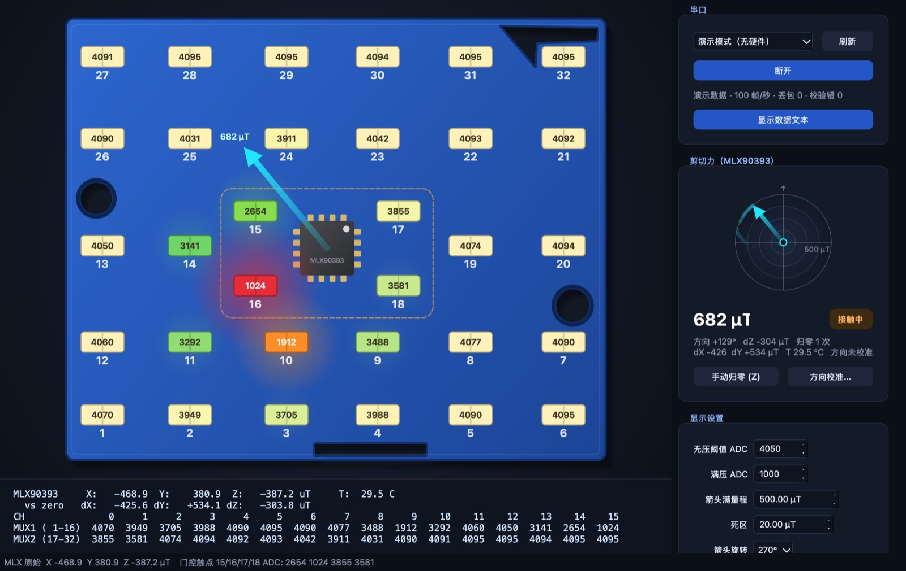
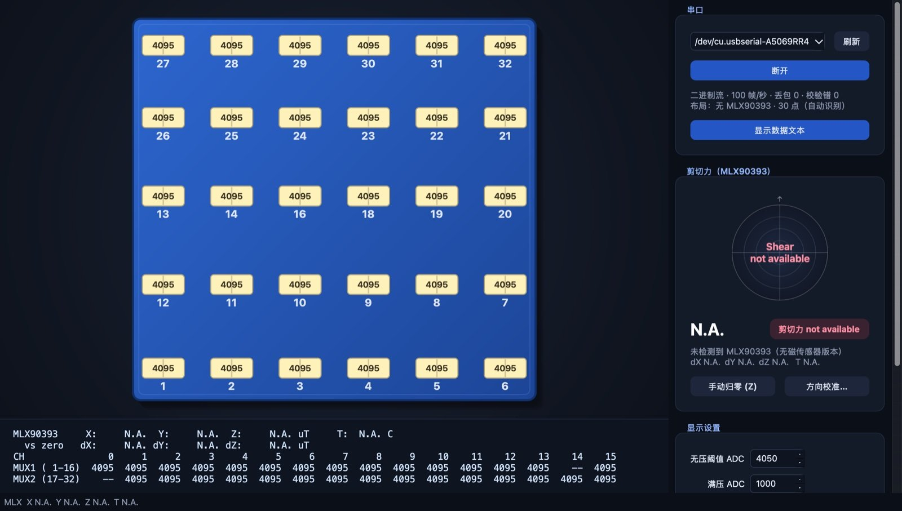

# 可视化程序使用说明 / Visualizer Guide

[返回 / Back](../README.md)

在 PCB 示意图上实时显示 32 个触点的压力，并用从 U3 出发的箭头显示 MLX90393 测得的剪切力方向。

Shows the pressure of all 32 taxels on a drawing of the PCB in real time, with an arrow from U3 showing the shear direction measured by the MLX90393.

| 带 MLX90393（演示数据）/ With MLX90393 (demo data) | 不带 MLX90393 / Without MLX90393 |
|---|---|
|  |  |

## 1. 安装与启动 / Install and run

需要 Python ≥ 3.9，依赖为 PyQt6 和 pyserial（见 `visualizer/requirements.txt`）。
Requires Python ≥ 3.9 with PyQt6 and pyserial (see `visualizer/requirements.txt`).

**macOS / Linux**：在 Finder 里双击 `visualizer/run.command`，或在终端运行（首次运行会自动创建 `.venv` 并安装依赖）：
**macOS / Linux**: double-click `visualizer/run.command` in Finder, or run it in a terminal (the first run creates `.venv` and installs the dependencies):
```
cd visualizer
./run.command                 # 在窗口里选择串口 / pick the port in the window
./run.command --demo          # 模拟数据，无需硬件 / simulated data, no hardware
./run.command --port /dev/cu.usbserial-XXXX     # 启动即连接 / connect at start
```

**Windows**
```
cd visualizer
python -m venv .venv
.venv\Scripts\pip install -r requirements.txt
.venv\Scripts\python tactile_viz.py
```

> 串口一次只能被一个程序打开：使用可视化程序前，先关闭 VS Code / `idf.py monitor` 的串口监视器。
> A serial port can only be opened by one program at a time: close the VS Code / `idf.py monitor` serial monitor first.

## 2. 自动识别传感器版本 / Automatic sensor version

程序根据有没有 MLX90393 数据自动切换 PCB 布局，不需要任何设置：收到有效的 MLX 数据，立即显示**带 MLX90393 的 32 点布局**（带 U3 和剪切力箭头）；连续 1 秒没有 MLX 数据，切换为**不带 MLX90393 的 30 点布局**（6 × 5，无 15、17 号触点，数据文本中 MUX1 CH14 和 MUX2 CH0 显示 `--`）。当前布局显示在串口状态行。布局定义见 `tactile_viz.py` 中的 `LAYOUT_MLX` 和 `LAYOUT_PLAIN`。

The PCB drawing follows the sensor version automatically, nothing to configure: valid MLX data switches immediately to the **32-taxel layout with MLX90393** (U3 and shear arrow); 1 s without MLX data switches to the **30-taxel layout without MLX90393** (6 × 5, taxels 15 and 17 removed; MUX1 CH14 and MUX2 CH0 show `--` in the data text). The active layout is shown in the serial status line. The layouts are `LAYOUT_MLX` and `LAYOUT_PLAIN` in `tactile_viz.py`.

## 2.1 连接 / Connecting

在右上角选择串口（`usbserial` / `usbmodem` 设备排在最前），点 **连接**。程序向固件发送 `b`，固件开始以 100 Hz 发送二进制数据包；断开时程序发送 `t`，固件恢复文本输出。状态行显示：

Pick the port at the top right (`usbserial` / `usbmodem` devices are listed first) and click **连接 (Connect)**. The program sends `b` and the firmware starts streaming binary packets at 100 Hz; on disconnect it sends `t` and the firmware returns to text output. The status line shows:

- `二进制流 · 100 帧/秒 · 丢包 0 · 校验错 0` — 正常 / normal (binary stream, frames per second, lost packets, checksum errors)
- `文本模式（固件未更新？）` — 固件不支持二进制流，程序改为解析 5 Hz 的文本输出；重新烧录 `tactile_sensor` 即可 / the firmware has no binary stream, the program falls back to the 5 Hz text output; reflash `tactile_sensor`
- 列表最后一项 `演示模式（无硬件）` 为模拟数据 / the last entry, `演示模式（无硬件）`, is simulated data

## 3. 压力显示 / Pressure display

| ADC | 颜色 / Colour |
|---|---|
| ≥ 无压阈值 / no-load threshold (默认 / default 4050) | 淡黄色 / light yellow |
| ↓ | 绿色 → 橘色 / green → orange |
| ≤ 满压 ADC / full-press ADC (默认 / default 1000) | 红色 / red |

- 颜色在各档之间连续渐变，受力的触点周围有光晕 / colours blend continuously; loaded taxels glow.
- 触点上显示 ADC 数值（可在设置里关闭），下方是红色编号 / the ADC value is printed on each taxel (can be turned off), its label below.
- 鼠标悬停在触点上显示编号、MUX 通道和 ADC 值 / hover a taxel to see its label, MUX channel and ADC value.
- 建议实测后把“满压 ADC”调到用力按压时的读数，让颜色用满整个范围 / after testing, set "满压 ADC" to the reading under a firm press so the colours use the full range.

## 4. 数据文本 / Data text

点 **显示数据文本**，PCB 下方出现等宽字体的数据面板（10 Hz 刷新）。每个字段宽度固定，数值变化时位置不会跳动；字号随窗口宽度自动缩放。再点一次隐藏。

Click **显示数据文本 (Show data text)** to open a fixed-width text panel under the PCB (10 Hz refresh). Every field has a fixed width so nothing shifts as values change; the font scales with the window width. Click again to hide it.

```
MLX90393     X:    -42.1  Y:   -153.2  Z:    -82.3 uT     T:  29.7 C
  vs zero   dX:     +0.0 dY:     +0.0 dZ:     +0.0 uT
CH               0     1     2     3     4     5 ...    15
MUX1 ( 1-16)  4095  4095  4095  4095  4095  4095 ...  4095
MUX2 (17-32)  4095  4095  4095  4095  4095  4095 ...  4095
```

## 5. 剪切力 / Shear

- **箭头**：从 U3 出发，方向为剪切方向，旁边标出大小（µT）。小于“死区”时不画箭头。右侧罗盘同时显示方向、角度、dX/dY/dZ 和轨迹。
- **Arrow**: starts at U3 and points in the shear direction, labelled with the magnitude (µT). Nothing is drawn below the dead band. The compass on the right shows the direction, angle, dX/dY/dZ and a short trail.
- 箭头长度只作参考，不是标定过的力值 / the arrow length is indicative only, not a calibrated force.
- 不带 MLX90393 的传感器：U3 处显示 `N.A.`，面板显示 “剪切力 not available” / sensors without an MLX90393 show `N.A.` at U3 and "剪切力 not available" in the panel.

### 5.1 自动归零 / Auto zero

当 U3 周围的 15、16、17、18 四个触点都 ≥ 无压阈值并保持 0.15 s，程序把最近 0.3 s 磁场的平均值设为原点，箭头回到中心（U3 周围虚线框为绿色，状态 “无接触 · 已归零”）。任意一个被按下时原点冻结（虚线框变橘色，状态 “接触中”），箭头开始显示剪切力。按 **手动归零** 或键盘 `Z` 可立即归零。

When taxels 15, 16, 17 and 18 around U3 are all ≥ the no-load threshold for 0.15 s, the mean field of the last 0.3 s becomes the origin and the arrow returns to the centre (dashed box around U3 turns green, state "无接触 · 已归零" = no contact, zeroed). As soon as any of them is pressed the origin is frozen (box turns orange, state "接触中" = contact) and the arrow shows the shear. **手动归零 (Manual zero)** or the `Z` key zeroes immediately.

### 5.2 方向校准 / Direction calibration

磁铁与芯片的相对位置、安装角度和两个轴的灵敏度都会让箭头方向偏差。点 **方向校准…**，按提示完成 6 步（每步点“开始记录”后有 1 秒准备时间）：

The magnet position, mounting angle and unequal axis gains all bend the arrow direction. Click **方向校准… (Direction calibration)** and follow the 6 steps (each step gives you 1 s to get ready after clicking "开始记录 / Start"):

1. 完全松开，记录零点和噪声 / release completely: zero and noise
2. 垂直按下再松开 2–3 次（只按不推）：测出按压引起的 dX/dY 串扰 kx、ky，之后从剪切信号中扣除 / press straight down and release 2–3 times (no pushing): measures the dX/dY crosstalk kx, ky caused by pressing, which is then subtracted
3. 按住朝 **右** 推并保持 / press and push **right**, hold
4. 朝 **上** / push **up**
5. 朝 **左** / push **left**
6. 朝 **下** / push **down**

方向以界面上 PCB 图为准。程序据 4 个方向拟合 2×2 矩阵，可同时修正任意安装角度、两轴灵敏度差异和轴不正交，并显示校准前后的方向误差。点 **保存并使用** 生效；**清除校准** 后恢复使用“箭头旋转 / 翻转 X / 翻转 Y”设置。每个方向用差不多的力度、推到位后保持不动，效果最好。

Directions are as seen on the PCB drawing in the window. A 2×2 matrix is fitted from the four pushes, correcting any mounting angle, unequal axis gains and non-orthogonal axes; the direction error before and after is shown. Click **保存并使用 (Save and use)**; **清除校准 (Clear calibration)** returns to the rotation / flip settings. Use a similar force for every direction and hold still once pushed.

> `tactile_viz.py` 中的 `DEFAULT_CFG["dir_cal"]` 是作者手上那块传感器的校准结果，换了传感器请重新校准。
> `DEFAULT_CFG["dir_cal"]` in `tactile_viz.py` is the calibration of the author's sensor; recalibrate for a different sensor.

## 6. 设置 / Settings

| 设置 / Setting | 默认 / Default | 说明 / Meaning |
|---|---|---|
| 无压阈值 ADC / no-load threshold | 4050 | ≥ 此值视为无压（淡黄色），也是自动归零的判定 / at or above = no load (light yellow), also used by the auto zero |
| 满压 ADC / full-press ADC | 1000 | ≤ 此值显示为全红 / at or below = full red |
| 箭头满量程 / arrow full scale | 500 µT | 剪切达到此值时箭头最长 / shear giving the longest arrow |
| 死区 / dead band | 20 µT | 小于此值不显示箭头；轻触时方向乱跳可调到 40–60 / no arrow below this; raise to 40–60 if the direction jitters on light contact |
| 箭头旋转、翻转 X/Y / rotation, flip X/Y | 270°（顺时针 90° / 90° clockwise） | 未做方向校准时使用 / used only without a direction calibration |
| 在触点上显示 ADC 数值 / show ADC values | 开 / on | |

设置自动保存在 `visualizer/viz_config.json`（不纳入 git），删除该文件即恢复默认。
Settings are saved to `visualizer/viz_config.json` (not tracked by git); delete it to return to the defaults.

## 7. 修改映射 / Changing the channel map

触点位置和通道对应关系都在 `tactile_viz.py` 开头：`TAXELS` / `TAXELS_PLAIN`（编号 → PCB 坐标，分别对应两个版本）、`CHANNEL_MAP`（编号 → MUX 与通道）、`ZERO_GATE_LABELS`（自动归零用的触点）。

Taxel positions and the channel map are defined at the top of `tactile_viz.py`: `TAXELS` / `TAXELS_PLAIN` (label → PCB position for the two versions), `CHANNEL_MAP` (label → MUX and channel) and `ZERO_GATE_LABELS` (taxels used for the auto zero).

## 8. 常见问题 / Troubleshooting

| 现象 / Symptom | 处理 / Fix |
|---|---|
| `串口错误：... busy` / serial error, port busy | 关闭串口监视器或其他占用该串口的程序 / close the serial monitor or any other program using the port |
| 列表中没有串口 / no port listed | 检查 USB 线（需数据线）是否插在 COM 口，点“刷新” / check the USB (data) cable is in the COM port, click 刷新 (Refresh) |
| `文本模式（固件未更新？）` / text mode | 重新烧录 `tactile_sensor` / reflash `tactile_sensor` |
| 箭头一直不归零 / arrow never re-zeroes | 15–18 号触点空载时不到无压阈值（未接或有预压），调低阈值或用手动归零 / taxels 15–18 do not reach the threshold without load (not connected or preloaded); lower the threshold or zero manually |
| 关闭程序后 VS Code 监视器显示乱码 / VS Code monitor shows garbage after the visualizer | 固件还在二进制模式（程序异常退出时没来得及发送 `t`），复位开发板即可 / the firmware is still in binary mode (the program exited before sending `t`); reset the board |
